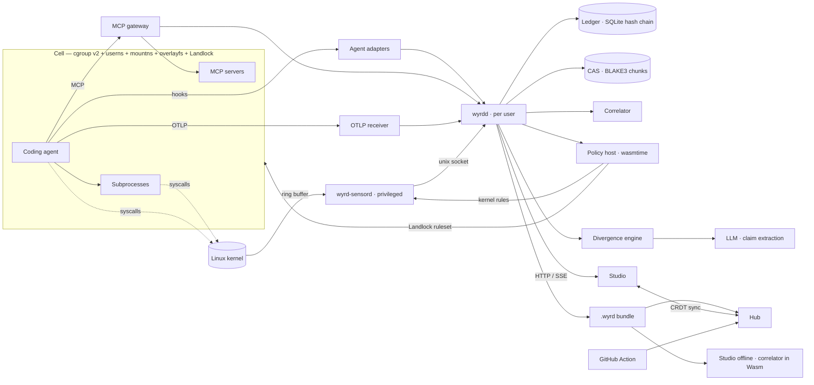
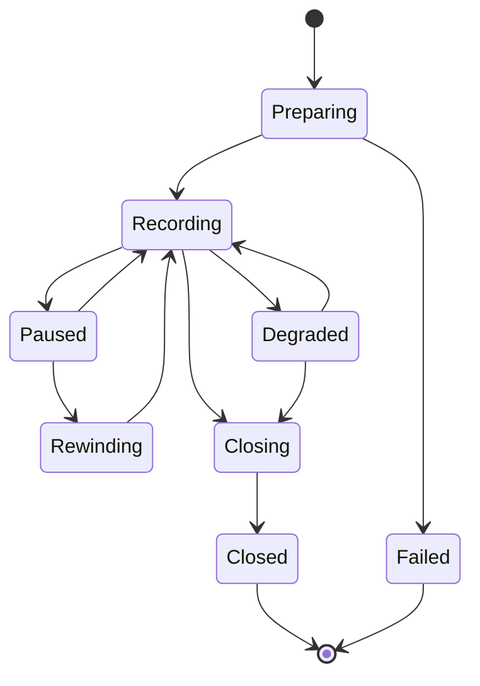

# Architecture overview

Wyrdline records what a coding agent says it does (intent), what it actually
does in the kernel (effect), and the state of the workspace after each step
(state), links them, and lets the user rewind, guard, verify, and share the
session.

## System diagram

## Planes

| Plane | Sources | Examples |
|---|---|---|
| Intent | hook adapters, MCP gateway, OTLP GenAI spans | tool call started/finished, assistant message |
| Effect | eBPF programs filtered by session cgroup | exec, file write/rename/unlink, connect, DNS |
| State | Cell checkpoints | checkpoint created / rewound / forked / applied |
| Guard | policy host, kernel enforcement | allow / deny / ask decisions |
| Verdict | divergence engine | claim extracted, divergence raised |
| Meta | daemon | session started/closed, sensor lost/resumed |

All planes are appended to one hash-chained event stream per session
([ADR-004](../adr/004-per-session-hash-chained-ledger.md)); every other view
is a projection of it.

## Components

| Component | Privilege | Responsibility |
|---|---|---|
| `wyrd-sensord` | `CAP_BPF`, `CAP_PERFMON`, `CAP_NET_ADMIN`, `CAP_SYS_RESOURCE` | load eBPF, stream events of registered cgroups, attach network enforcement |
| `wyrdd` | user | sessions, Cells, ledger, CAS, correlation, policies, divergence, API, Studio |
| `wyrd` | user | CLI client; `doctor`, `verify`, `open` work standalone |
| `wyrd-gateway` | user, inside the session | MCP proxy with policy checks |
| Studio | browser | live mode against `wyrdd`; bundle mode fully offline |
| Hub | server | bundle storage, dashboards, search, CRDT sync, CI ingest |

## Trust boundaries

| # | Boundary | Rule |
|---|---|---|
| B1 | Agent ↔ Wyrdline | The agent, its inputs (repo files, web pages, MCP results), and its outputs are untrusted. |
| B2 | `wyrdd` ↔ `wyrd-sensord` | The sensor streams events only for cgroups owned by the peer UID (`SO_PEERCRED`). |
| B3 | Cell ↔ host | Landlock and cgroup BPF confine the agent; the daemon socket is outside its reach. |
| B4 | Local ↔ Hub | Bundles are redacted and signed before leaving the machine and verified on ingest. |
| B5 | Wyrdline ↔ LLM provider | Only redacted transcript excerpts are sent; never secrets or file contents. |
| B6 | Policy host ↔ policy guest | Guests get no ambient WASI capabilities; fuel and memory are capped. |

## Session lifecycle

Every transition writes a `meta.*` event. A Degraded session (sensor lost,
ring-buffer drops, Landlock downgrade) can never be presented as complete.
